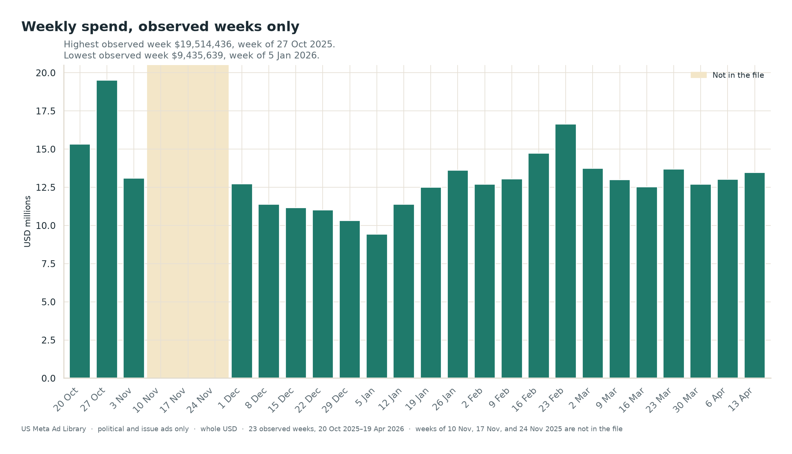
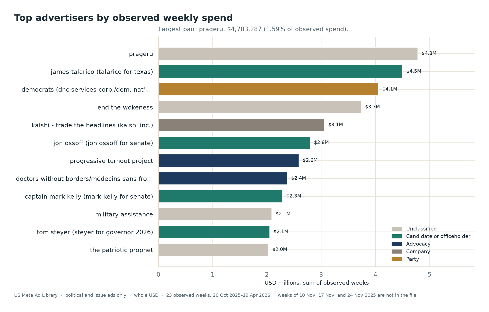
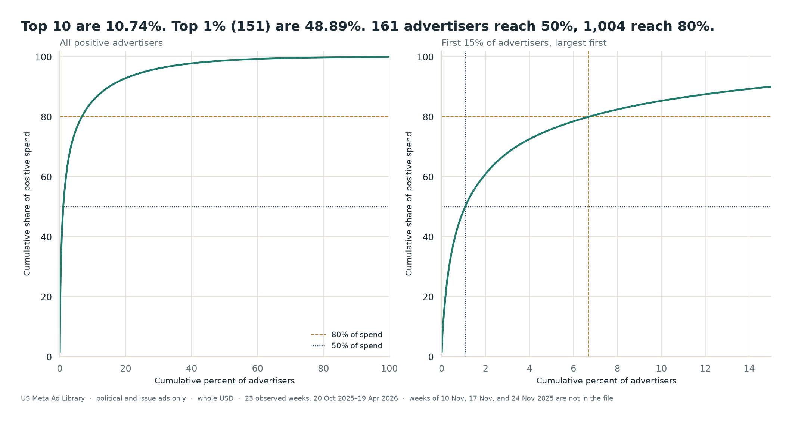
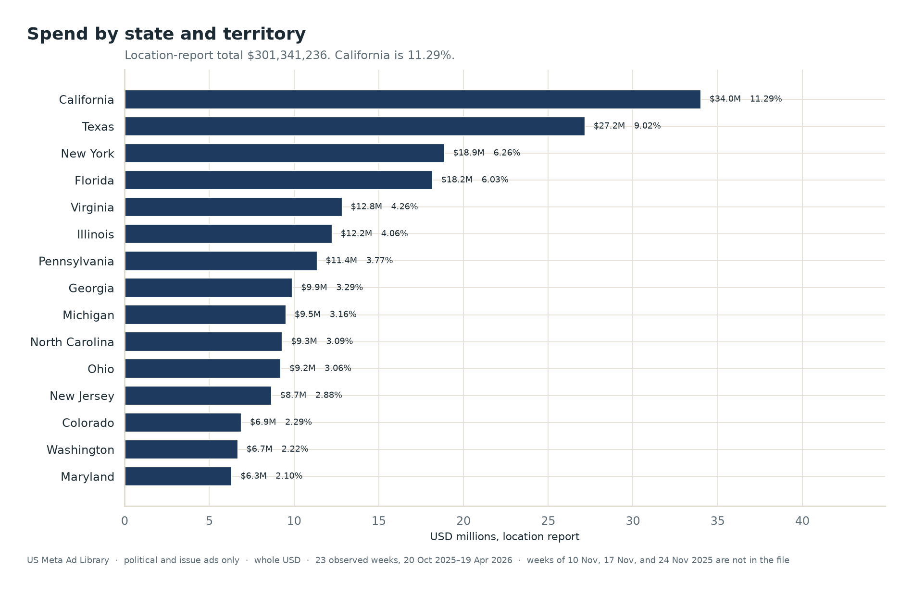
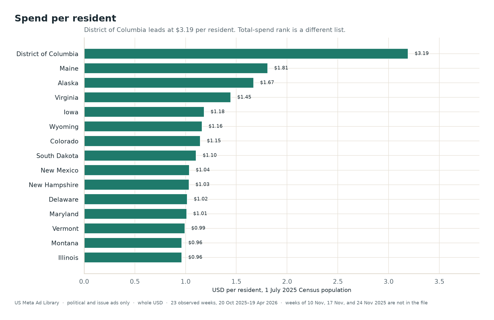
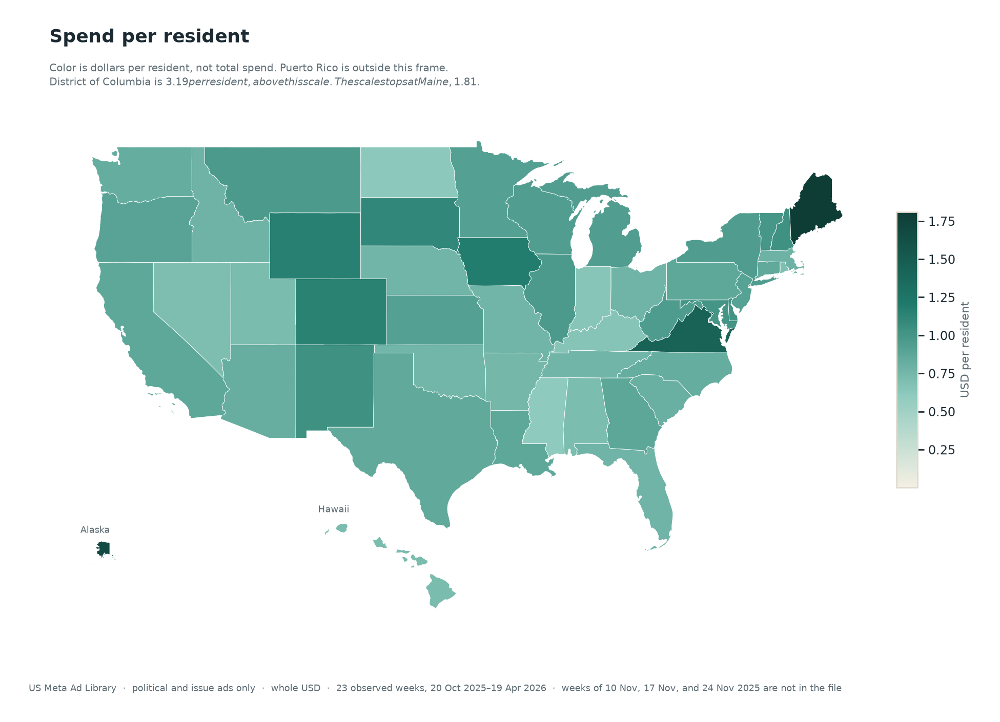
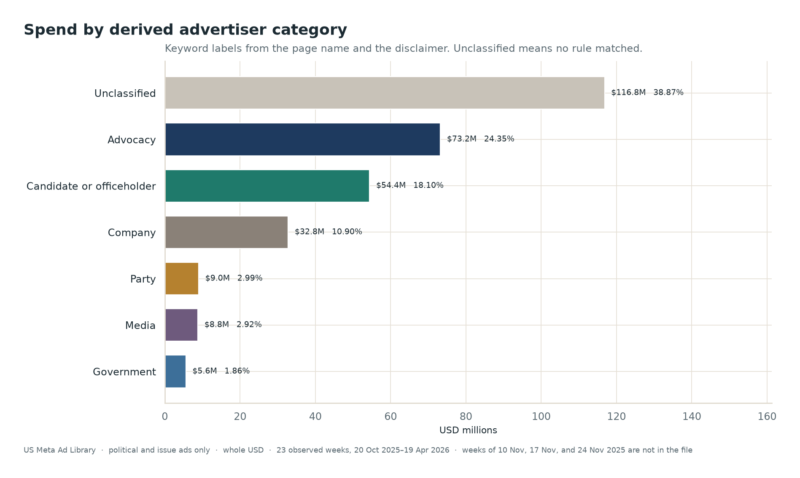
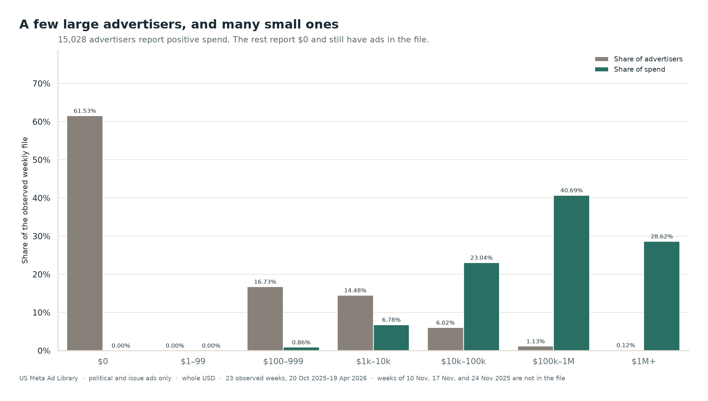
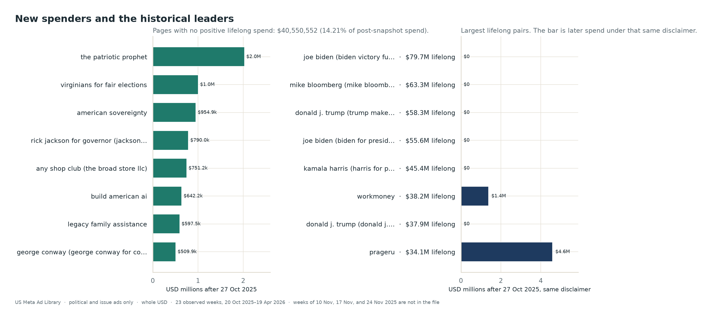

# US Meta political and issue ad spend, late 2025 to early 2026

**Sonya Baigildin** · [github.com/SonyaBai](https://github.com/SonyaBai)

Advertisers reported **$300,611,319** on Meta ads about social issues, elections, or politics across 23 observed weeks from 20 October 2025 through 19 April 2026. That is the sum of the weekly advertiser file. It is not a full six months: the weeks of 10 November, 17 November, and 24 November 2025 are missing, and they are not filled in. A separate lifelong snapshot, cumulative through 25 October 2025, is **$5,347,140,271**. Those two totals are not added together. The first observed week overlaps the snapshot, and the historical total is dominated by committees that are not spending in the later weeks.

The file has spend and ad counts. It has no clicks, conversions, or revenue. A large advertiser here is a large spender, not a proven one.

## Dataset

Public Kaggle dataset [Meta Ad Library Weekly](https://www.kaggle.com/datasets/ktkehoe/meta-ad-library-weekly) by Thomas Kehoe (`ktkehoe`), license [Apache 2.0](https://www.apache.org/licenses/LICENSE-2.0). It is a compilation of Meta's official US Ad Library reports: [facebook.com/ads/library/report/?country=US](https://www.facebook.com/ads/library/report/?country=US). Meta does not keep the old weekly downloads on that page. The compilation is the weekly record used here.

`scripts/download_data.py` fetches the zip and unzips three CSVs into `data/raw/`. Those files are gitignored. The committed tables in `data/processed/` are the aggregates behind the charts.

| File | What a row is | Rows | Observed-week spend |
| --- | --- | --- | --- |
| `META_AD_LIBRARY.ADVERTISERS.csv` | Page, disclaimer, and week | 154,301 weekly, plus 561,380 lifelong | $300,611,319 |
| `META_AD_LIBRARY.LOCATIONS.csv` | Geography and week | 1,310 weekly, plus 57 lifelong | $301,341,236 |
| `META_AD_LIBRARY.REGIONS.csv` | Page, region, and week | 3,285,468 weekly, no lifelong file | $276,382,659 |

The location report is **$729,917** above the advertiser file (0.24%). The region file is **$24,958,577** below the location report. State totals in this write-up use the location report, because it is the geographic rollup and it sits close to the advertiser total. The region file is loaded so the gap can be checked. It is not used as the state total.

Amounts are whole US dollars, as printed. There are no cents in the compilation. The country cut is the United States. The subject cut is ads about social issues, elections, or politics. Commercial ads outside that cut are not here.

`window = last_7_days` is one Monday–Sunday report. The observed weeks run from 20 October 2025 to 19 April 2026, with the three November weeks absent. `window = lifelong` has a blank start date and an end date of 25 October 2025. The compiler describes that file as everything available before the weekly series, through that date. The week of 20–26 October overlaps it.

Population for the per-resident figures is the U.S. Census Bureau Population Division's Vintage 2025 estimate of the resident population on 1 July 2025, column `POPESTIMATE2025`, summary level 040 (states, the District of Columbia, and Puerto Rico), file `NST-EST2025-ALLDATA`:

<https://www2.census.gov/programs-surveys/popest/datasets/2020-2025/state/totals/NST-EST2025-ALLDATA.csv>

The table page is <https://www.census.gov/data/tables/time-series/demo/popest/2020s-state-total.html>. The extract committed here is `data/external/state_population_2025.csv`. American Samoa, Guam, the Northern Mariana Islands, and the U.S. Virgin Islands are in the location report and are not in that vintage file, so they have no per-resident figure. The map polygons are the Census Bureau's 2024 cartographic boundary file at 1:20,000,000 (`cb_2024_us_state_20m`), reduced to name, postal abbreviation, and GEOID.

## Tools

Python (pandas, matplotlib, seaborn) for the tables and charts. SQLite for the same questions in SQL. Jupyter for the walkthrough in `notebooks/meta_ad_spend_analysis.ipynb`.

The region file is about 3.3 million rows. `sql/load_sqlite.py` streams it into SQLite in batches and builds indexes after the insert. The queries do not read that file into one dataframe.

## Metric definitions

An **advertiser** is a page id plus the exact disclaimer string. That is the grain of the report. `facebook, inc.` and `facebook inc.` stay two rows. A new committee on an old page stays a new row.

| Measure | Definition |
| --- | --- |
| Observed weekly spend | Sum of `amount_spent_usd` where `window = last_7_days`. Missing weeks are left out, not set to zero. |
| Lifelong spend | Sum where `window = lifelong`. Not added to the weekly sum. |
| Post-snapshot spend | Weekly spend in weeks that start on or after 27 October 2025. The week of 20 October is excluded because it overlaps the snapshot through 25 October. |
| Ad-weeks | Sum of `num_ads` across weekly rows. An ad reported in four weeks counts four times. This is not a count of distinct ads. |
| Spend per ad-week | Observed weekly spend divided by ad-weeks, half-up to the cent. |
| Positive advertiser | A page-and-disclaimer pair whose observed weekly spend is above zero. |
| Top 1% | The largest `ceil(n / 100)` positive advertisers, implemented as integer `(n + 99) / 100`. Rank is spend, then page id, then disclaimer. |
| Spend per resident | Location-report spend divided by the 1 July 2025 resident population, half-up to the cent. |
| Category | Keyword rule in `src/classify.py`. Not a Meta field. |

`python analysis.py` prints the figures below. Rates are half-up.

## 1. Weekly spend



The 23 observed weeks sum to **$300,611,319**. The week of 27 October 2025 is the high, at **$19,514,436**. The week of 5 January 2026 is the low, at **$9,435,639**. The shaded band is the three weeks that are not in the file. The line is not connected across them, and those weeks are not imputed.

| Week starting | Spend | Ad-weeks | Advertiser rows |
| --- | --- | --- | --- |
| 20 Oct 2025 | $15,329,496 | 209,679 | 8,242 |
| 27 Oct 2025 | $19,514,436 | 196,877 | 9,131 |
| 3 Nov 2025 | $13,088,002 | 179,904 | 8,692 |
| 10 Nov 2025 | not in the file | | |
| 17 Nov 2025 | not in the file | | |
| 24 Nov 2025 | not in the file | | |
| 1 Dec 2025 | $12,722,285 | 196,745 | 5,506 |
| 8 Dec 2025 | $11,383,446 | 135,931 | 5,327 |
| 15 Dec 2025 | $11,160,167 | 190,214 | 5,273 |
| 22 Dec 2025 | $11,001,279 | 140,416 | 4,758 |
| 29 Dec 2025 | $10,306,159 | 169,524 | 4,743 |
| 5 Jan 2026 | $9,435,639 | 145,083 | 4,885 |
| 12 Jan 2026 | $11,376,881 | 175,246 | 5,462 |
| 19 Jan 2026 | $12,486,035 | 160,923 | 5,555 |
| 26 Jan 2026 | $13,605,661 | 152,805 | 5,878 |
| 2 Feb 2026 | $12,696,045 | 143,852 | 6,273 |
| 9 Feb 2026 | $13,047,394 | 147,627 | 6,590 |
| 16 Feb 2026 | $14,720,595 | 142,139 | 7,130 |
| 23 Feb 2026 | $16,624,793 | 134,054 | 7,539 |
| 2 Mar 2026 | $13,740,856 | 135,743 | 7,593 |
| 9 Mar 2026 | $12,987,204 | 133,257 | 6,880 |
| 16 Mar 2026 | $12,512,024 | 119,131 | 7,161 |
| 23 Mar 2026 | $13,695,690 | 109,593 | 7,341 |
| 30 Mar 2026 | $12,705,508 | 129,980 | 7,738 |
| 6 Apr 2026 | $13,009,581 | 159,202 | 8,052 |
| 13 Apr 2026 | $13,462,143 | 130,617 | 8,552 |

What the series shows, and nothing past that: spend falls from the week of 27 October through the week of 5 January, including a step down in each of the five observed weeks from 1 December through 29 December. It then rises to $16,624,793 in the week of 23 February, the second-highest observed week. From the week of 2 March through the week of 13 April, every observed week is between $12,512,024 and $13,740,856.

The week of 20 October, **$15,329,496**, is inside the lifelong snapshot through 25 October. Post-snapshot spend, the other 22 weeks, is **$285,281,823**.

One location is absent in one week: the Northern Mariana Islands in the week of 8 December 2025. That geography sums to $0 in the weeks where it is present, so the hole does not move a state total.

## 2. Who spends, and how concentrated it is



There are 39,063 page-and-disclaimer pairs in the weekly file. **15,028** of them have positive spend. The largest is prageru, at **$4,783,287** (1.59% of observed spend). The top 10 together are **$32,293,328**, which is **10.74%**. No single page is the market.

| Advertiser | Category | Observed spend | Same disclaimer, lifelong | Weeks |
| --- | --- | --- | --- | --- |
| prageru | Unclassified | $4,783,287 | $34,125,203 | 23 |
| james talarico (talarico for texas) | Candidate or officeholder | $4,502,909 | $0 | 17 |
| democrats (dnc services corp./dem. nat'l committee) | Party | $4,059,837 | $24,439,798 | 23 |
| end the wokeness | Unclassified | $3,739,557 | $6,645,893 | 23 |
| kalshi - trade the headlines (kalshi inc.) | Company | $3,059,787 | $5,685,645 | 17 |
| jon ossoff (jon ossoff for senate) | Candidate or officeholder | $2,797,795 | $9,105,970 | 23 |
| progressive turnout project | Advocacy | $2,590,820 | $22,664,752 | 23 |
| doctors without borders/médecins sans frontières (msf) | Advocacy | $2,377,451 | $6,438,476 | 23 |
| captain mark kelly (mark kelly for senate) | Candidate or officeholder | $2,290,055 | $13,459,364 | 23 |
| military assistance | Unclassified | $2,091,830 | $495,672 | 22 |
| tom steyer (steyer for governor 2026) | Candidate or officeholder | $2,051,108 | $0 | 20 |
| the patriotic prophet | Unclassified | $2,029,241 | $0 | 17 |

`talarico for texas` and `steyer for governor 2026` are $0 in the lifelong file under those exact strings. The pages are not new. James Talarico's page also has `james talarico campaign` at $2,025,112 lifelong and $482,894 in the observed weeks. Tom Steyer's page has `tom steyer 2020` at $22,322,872 lifelong. The table is the disclaimer, not the person.



Among the 15,028 positive advertisers:

| Cut | Advertisers | Spend | Share |
| --- | --- | --- | --- |
| Top 10 | 10 | $32,293,328 | 10.74% |
| Top 1% | 151 | $146,954,072 | 48.89% |
| To reach 50% of positive spend | 161 | | 50% |
| To reach 80% of positive spend | 1,004 | | 80% |

**161** advertisers, just past the top 1%, are half the positive dollars. **1,004** advertisers are 80%. The other 14,024 positive advertisers are the last 20%. The median positive advertiser spent **$1,441**. The mean is **$20,003.41**. The mean is the total pulled up by the right tail.

Advertisers seen in only one observed week account for **$1,375,342**, **0.46%** of spend. Advertisers seen in 10 or more of the 23 weeks account for $232,635,479, 77.39%. Most of the money is in pages that stay in the file, not in one-week bursts.

## 3. Spend by state



The location report sums to **$301,341,236**. California is **$34,010,698**, 11.29%. California, Texas, New York, and Florida together are 32.60%. `unknown` is **$14,854**, which rounds to 0.00% of the location total. It is not spread across states.

| Location | Spend | Share | Per resident |
| --- | --- | --- | --- |
| California | $34,010,698 | 11.29% | $0.86 |
| Texas | $27,172,150 | 9.02% | $0.86 |
| New York | $18,878,870 | 6.26% | $0.94 |
| Florida | $18,175,183 | 6.03% | $0.77 |
| Virginia | $12,835,661 | 4.26% | $1.45 |
| Illinois | $12,245,495 | 4.06% | $0.96 |
| Pennsylvania | $11,358,744 | 3.77% | $0.87 |
| Georgia | $9,903,919 | 3.29% | $0.88 |
| Michigan | $9,523,755 | 3.16% | $0.94 |
| North Carolina | $9,311,219 | 3.09% | $0.83 |
| Ohio | $9,218,859 | 3.06% | $0.77 |
| New Jersey | $8,673,317 | 2.88% | $0.91 |





Per resident, the order changes. The **District of Columbia** is **$3.19** on $2,215,004 of spend (0.74% of the location total). Maine is $1.81. Alaska is $1.67. Virginia is the large state that is also high per resident, at $1.45. California and Texas, first and second in total spend, are both $0.86. The bottom of the per-resident list, among places with a Census population in this vintage, is Puerto Rico at $0.00 on $7,097, then Mississippi at $0.61, North Dakota at $0.62, Indiana at $0.65, and Kentucky at $0.65.

The map colors dollars per resident, not total spend. The District of Columbia is above the color scale so the other states still separate. Puerto Rico is outside the frame. American Samoa, Guam, the Northern Mariana Islands, and the U.S. Virgin Islands are in the location file and are omitted from the per-resident ranking because this Census vintage does not include them.

## 4. Categories read from the name



Meta does not ship a category. `src/classify.py` labels the disclaimer and the page name with keywords, and the higher-priority match wins: party, then candidate or officeholder, then government, then media, then advocacy, then company. A personal name with no office, state, or committee phrase stays **Unclassified**.

The rules treat `{name} for {state}` as a candidate, which also catches a few issue names. `Inc.` and `LLC` count as a company only if no advocacy word matched first, so a lot of nonprofits that are simply "Inc." land in company. Bare `co` is not used, because in this file it also means county or Colorado. A short list of outlet names (`newsmax`, `politico`, `the new yorker`, and a few others) is in the media rule because those names do not contain "news" or "times" as a separate word.

| Category | Spend | Share of observed spend | Positive advertisers |
| --- | --- | --- | --- |
| Unclassified | $116,835,684 | 38.87% | 6,827 |
| Advocacy | $73,213,037 | 24.35% | 2,053 |
| Candidate or officeholder | $54,409,681 | 18.10% | 4,233 |
| Company | $32,774,688 | 10.90% | 767 |
| Party | $8,995,005 | 2.99% | 301 |
| Media | $8,787,340 | 2.92% | 305 |
| Government | $5,595,884 | 1.86% | 542 |

Unclassified is the largest bucket, at **38.87%**. That is the limit of the method, not a finding that a third of the money has no type. prageru, end the wokeness, and hillsdale college are in that bucket because the names do not carry the words the rules look for. Party committees are 2.99% of observed spend under this rule. The DNC row is in that 2.99%. A share this small is not a claim that parties are absent. It is a claim about names the rule recognized.

Company includes kalshi inc. and meta (`facebook inc.`, $1,942,122 in the observed weeks). Those are advertisers whose ads were in the social-issue, election, or politics report. The bucket does not say the firm is a political committee.

## 5. Spend per ad, and the size of the advertisers



There are **3,538,542** ad-weeks in the observed file. Spend per ad-week is **$84.95**. On rows with a positive dollar amount the figure is **$90.40**.

**73,604** of **154,301** weekly rows are $0. Those rows hold **213,354** ad-weeks, **6.03%** of ad-weeks. So almost half the rows are $0, and they are not half the ads. No weekly row has a positive amount below $101. The compiler notes that the source reports have a spend threshold. This file does not say what the threshold is, and these totals do not replace a $0 with an estimate.

| Observed spend of the pair | Advertisers | Share of advertisers | Spend | Share of spend | Spend per ad-week |
| --- | --- | --- | --- | --- | --- |
| $0 | 24,035 | 61.53% | $0 | 0.00% | $0.00 |
| $1–$99 | 0 | 0.00% | $0 | 0.00% | n/a |
| $100–$999 | 6,534 | 16.73% | $2,582,823 | 0.86% | $22.06 |
| $1,000–$9,999 | 5,656 | 14.48% | $20,377,265 | 6.78% | $20.84 |
| $10,000–$99,999 | 2,350 | 6.02% | $69,270,786 | 23.04% | $42.21 |
| $100,000–$999,999 | 441 | 1.13% | $122,332,217 | 40.69% | $221.56 |
| $1,000,000 or more | 47 | 0.12% | $86,048,228 | 28.62% | $554.51 |

**24,035** pairs never leave $0. They are 61.53% of pairs and none of the dollars. The 47 pairs at $1,000,000 or more are **0.12%** of pairs and **28.62%** of spend, at $554.51 per ad-week. Pairs between $100 and $9,999 are about a third of the file and under 8% of the spend, at about $21 to $22 per ad-week. The big advertisers are not just running more of the same ads. Each reported ad-week on those rows is much more expensive.

## 6. The weekly window against the lifelong snapshot



The lifelong file is a different list. Of the **$5,347,140,271** in that snapshot, **$3,513,174,873** (65.70%) sits on page-and-disclaimer pairs that have no positive spend in the weeks starting 27 October 2025 or later.

| Lifelong pair | Lifelong spend | Spend after 27 Oct 2025, same disclaimer | Same page, any disclaimer |
| --- | --- | --- | --- |
| joe biden (biden victory fund) | $79,741,106 | $0 | $0 |
| mike bloomberg (mike bloomberg 2020 inc) | $63,326,609 | $0 | $16,234 |
| donald j. trump (trump make america great again committee) | $58,272,160 | $0 | $7,491 |
| joe biden (biden for president) | $55,620,180 | $0 | $0 |
| kamala harris (harris for president) | $45,387,840 | $0 | $0 |
| workmoney | $38,196,437 | $1,391,153 | $1,391,153 |
| donald j. trump (donald j. trump for president, inc.) | $37,910,564 | $0 | $7,491 |
| prageru | $34,125,203 | $4,594,317 | $4,596,882 |

Biden Victory Fund is the largest lifelong row and has nothing in the later weeks, on that disclaimer or on that page. Bloomberg's and Trump's historical disclaimers are also at $0 later. The pages still show $16,234 and $7,491 under other strings. prageru is on both lists: $34,125,203 lifelong and $4,594,317 after 27 October under the same name. The DNC row in the weekly top 15 is the same pattern at a smaller scale, $24,439,798 lifelong and $3,906,989 later.

Two definitions of "new," both on the post-snapshot weeks:

| Definition | Pairs | Post-snapshot spend | Share of post-snapshot spend |
| --- | --- | --- | --- |
| Page has no positive lifelong spend | 5,226 | $40,550,552 | 14.21% |
| Disclaimer is new, page already had lifelong spend | 895 | $18,945,960 | 6.64% |
| Either (the disclaimer string is new) | 6,121 | $59,496,512 | 20.86% |

**5,226** pages are new in the sense that the page id has no positive lifelong dollars. They are **$40,550,552**, **14.21%** of post-snapshot spend. The largest is the patriotic prophet, at **$2,029,241**. That page has no lifelong row. The next names on that list are smaller: virginians for fair elections at $1,006,519, american sovereignty at $954,865.

The other **$18,945,960** is new disclaimer text on a page that already had lifelong spend. Talarico and Steyer, in the weekly top 15, are in that group. They are newly large committees, not new pages.

## 7. What the calendar shows

Section 1 is the calendar. There is no day-of-week split, because the report is a Monday–Sunday total. There is no November read for the three missing weeks. The shape that is in the file is a high in the week of 27 Oct 2025, a low in the week of 5 Jan 2026, a second high in the week of 23 Feb 2026, and then a band from $12,512,024 to $13,740,856 through the week of 13 Apr 2026.

Advertiser rows also move. The first three observed weeks have 8,242, 9,131, and 8,692 rows. After the gap, the week of 1 December has 5,506, and the count climbs back to 8,552 in the week of 13 April. Spend does not follow that count one for one: the week of 23 February is the second-highest spend week, on 7,539 rows, while the week of 13 April has more rows and less spend.

## 8. What a media buyer can take from this

The file can support a budget and a target list. It cannot support a performance claim.

**The competitive set is small.** Half of the positive dollars are 161 advertisers. Eighty percent are 1,004. A weekly export of every page, including the 24,035 at $0, overstates how many advertisers are actually buying. The names worth knowing this window are the ones at $100,000 and up: 488 pairs, and 69.31% of the spend ($122,332,217 plus $86,048,228).

**Spend is not a result.** There is no click, lead, or vote in the file. prageru at $4,783,287 and a page at $1,441 are not comparable on efficiency. The only intensity in the file is dollars per reported ad-week: $84.95 overall, about $22 under $10,000 of total spend, and $554.51 for the pairs at $1,000,000 or more.

**Copying total spend by state is a large-state plan.** California and Texas are 20.30% of location-report spend and $0.86 per resident. The District of Columbia is $3.19 per resident on 0.74% of the dollars. Virginia is the state that shows up on both rankings. A national plan that mirrors the dollar map will buy California and miss the per-resident outliers. The region file is $24,958,577 short of the location total, so a page-by-state buy list built only from that file is light.

**The lifelong leaderboard is the wrong list for a flight now.** Biden Victory Fund, Bloomberg 2020, and the Trump and Harris presidential committees lead the snapshot and are at or near $0 after 27 October 2025. prageru, the DNC, WorkMoney, and Progressive Turnout Project are on both lists. New pages are 14.21% of the later dollars. A pitch aimed at "the biggest political advertisers in the archive" is aimed at 2020 committees.

**Do not plan November from this file.** Three weeks are absent. The total of $300,611,319 is 23 weeks, not 26. Adding the lifelong $5,347,140,271 on top would count late October twice and would mix six years of archive with one season.

**The category chart is a floor, not a taxonomy.** Unclassified is 38.87%. Advocacy at 24.35% and candidates at 18.10% are the names the rules caught. They are not the share of the market that is advocacy or a candidate.

## How to run

Python 3.11 or newer.

```bash
python -m venv .venv
source .venv/bin/activate
pip install -r requirements.txt
python scripts/download_data.py
python analysis.py
```

`python scripts/download_data.py` requests the public archive and writes `data/raw/`. No Kaggle login is required. If the www host returns a challenge page instead of a zip, the script asks `api.kaggle.com` for the same file.

`python analysis.py` reloads SQLite, rewrites `data/processed/`, rewrites the charts in `images/`, and prints every figure in this file. The database is `data/meta_ad_library.db`. It is gitignored. Rebuild it on its own with:

```bash
python sql/load_sqlite.py
sqlite3 -header -column data/meta_ad_library.db < sql/01_weekly_spend.sql
```

`sql/02_top_advertisers.sql` and `sql/05_categories.sql` read `classified_weekly`, which `python analysis.py` fills after the load. The other questions are `sql/03_concentration.sql` through `sql/10_lifelong_top.sql`. `sql/stage_advertisers.sql` and `sql/extract_advertisers.sql` are the staged join the loader uses. Running the extract on its own, without the stage script on the same connection, will not find the temp tables.

Open `notebooks/meta_ad_spend_analysis.ipynb` from the repository root. It reads `data/processed/` and does not need the raw CSVs. Re-execute it from the repository root.

## Repository

```
.
├── analysis.py                         # entry point
├── scripts/download_data.py            # fetch the Kaggle zip into data/raw/
├── data/
│   ├── external/                       # Census population and state polygons
│   ├── processed/                      # aggregates committed for the charts
│   └── raw/                            # gitignored; created by the download
├── images/                             # charts embedded above
├── notebooks/meta_ad_spend_analysis.ipynb
├── sql/
│   ├── schema.sql
│   ├── load_sqlite.py
│   └── 01_weekly_spend.sql … 10_lifelong_top.sql
├── src/                                # categories, metrics, charts
├── requirements.txt
└── LICENSE                             # MIT, Sonya Baigildin, 2026
```

`data/meta_ad_library.db` is created locally and is not committed.

## Caveats

- The subject is ads about social issues, elections, or politics in the United States. It is not the Meta ads market.
- Spend is what Meta printed. There are no clicks or outcomes. $0 rows are left at $0. No weekly row shows a positive amount below $101, and the compilation says the source reports use a spend threshold. The threshold is not in the file.
- Three November weeks are missing. Totals are sums of observed weeks.
- The lifelong snapshot is a different table. It overlaps the week of 20 October 2025. It is not added to the weekly total.
- The location report, the advertiser file, and the region file do not sum to the same dollar. State figures use the location report.
- Advertiser identity is page id plus the exact disclaimer string. Punctuation splits a payer. A new committee on an old page is a new row.
- Summing `num_ads` across weeks counts ad-weeks, not distinct ads.
- Categories are keyword rules. Unclassified is 38.87% of observed spend. The classified shares are not a complete taxonomy.
- Per-resident figures use the 1 July 2025 resident population. They are not a cost per voter, and they are not adjusted for the three missing weeks.
